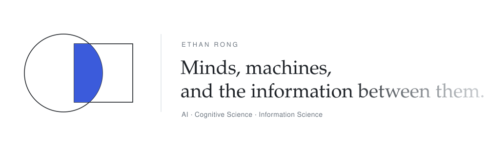

<a href="https://ethan-rong.github.io">
<picture>
  <source media="(prefers-color-scheme: dark)" srcset="assets/hero-dark.svg">
  
</picture>
</a>

<a href="https://ethan-rong.github.io"><b>ethan-rong.github.io</b></a> &nbsp;·&nbsp;
<a href="https://github.com/ethan-rong/kaggriculture">Kaggriculture</a>&nbsp; bronze, 702nd of 10,148 &nbsp;·&nbsp;
<a href="https://github.com/ethan-rong/dat-parkinsons-challenge">DaT Parkinson's</a>&nbsp; 65th &nbsp;·&nbsp;
<a href="https://whosbluffing.com">Who's Bluffing</a> &nbsp;·&nbsp;
<a href="https://www.kaggle.com/rngrng">Kaggle</a>

